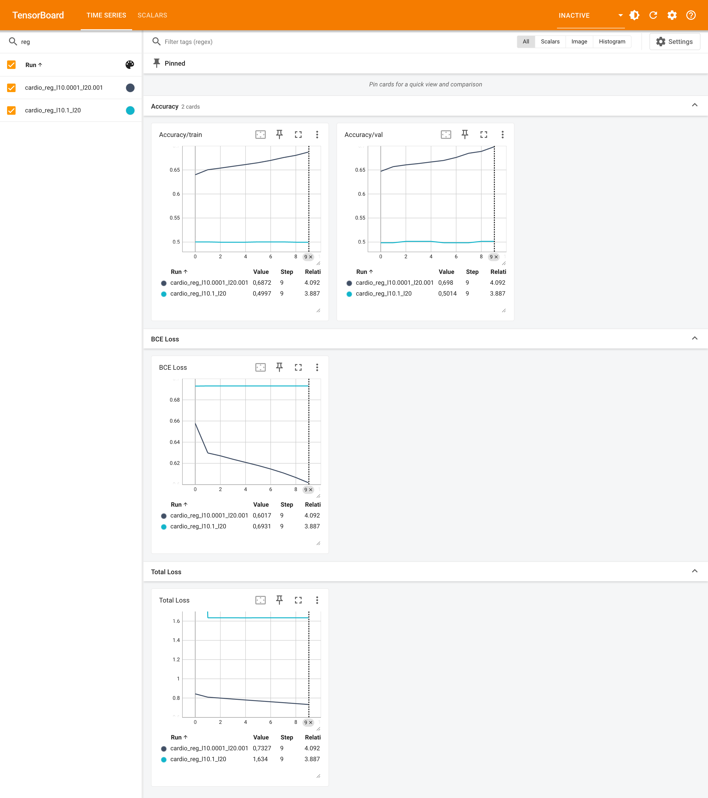
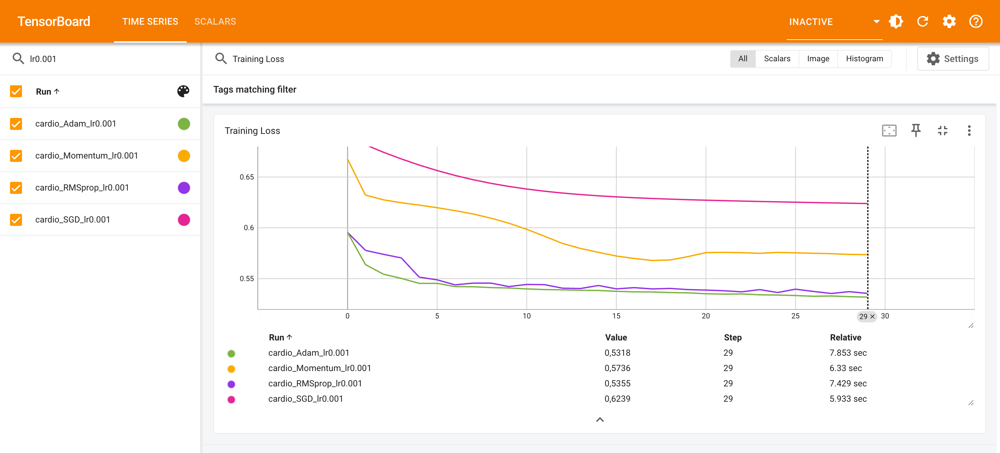
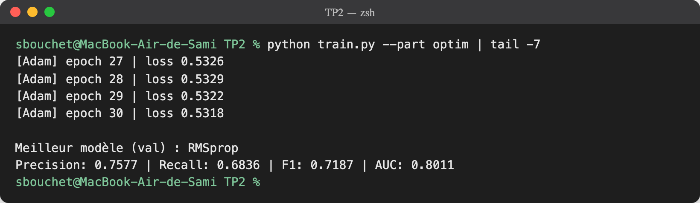

# TP2 — Régularisation, optimisation et métriques (CSC 8607 – Introduction au deep learning)

**Identifiant TSP :** sbouchet

Fichiers du rendu :

- `dataset.py` : classe `CardioDataset` + fonction `get_loaders()` (split 80/10/10 et DataLoaders)
- `train.py` : MLP, entraînement avec régularisation L1/L2, comparaison des optimiseurs, évaluation (precision, recall, F1, AUC)
- `data/cardio_train.csv` : dataset Kaggle *Cardiovascular Disease* (non versionné, ignoré par `.gitignore`)

Lancement :

```bash
python dataset.py              # test du dataset
python train.py --part reg     # partie 2 (régularisation)
python train.py --part optim   # parties 3 et 4 (optimiseurs + métriques)
python train.py                # tout
tensorboard --logdir=runs
```

---

## Exercice 1 — Création d'un dataset personnalisé


### Pourquoi faire `StandardScaler()` sur tout le dataset avant le split est une mauvaise pratique ?

Le `StandardScaler` calcule la moyenne et l'écart-type de chaque feature. Si on le fait sur tout le dataset avant le split, ces statistiques sont calculées en utilisant aussi les données de validation et de test. Des informations du test « fuient » donc dans l'entraînement : c'est ce qu'on appelle le **data leakage**.

Le problème, c'est que le test est censé simuler des données jamais vues. Avec la fuite, l'évaluation est un peu trop optimiste et ne reflète plus vraiment ce qui se passerait en production, où on ne connaît pas les nouvelles données à l'avance.

La bonne pratique : faire le split d'abord, faire `scaler.fit()` **uniquement sur le train**, puis appliquer ce même scaler (`transform()`) au val et au test.

### Si le dataset ne tenait pas en RAM (ex : 500 Go) ?

J'utiliserais un **`torch.utils.data.IterableDataset`** à la place de `Dataset`. Au lieu d'avoir un accès par index (`__getitem__`) qui suppose que tout est chargé en mémoire, on définit `__iter__` qui lit les données en flux (streaming), par exemple morceau par morceau avec `pd.read_csv(..., chunksize=...)`. On n'a ainsi jamais tout le dataset en mémoire en même temps.

---

## Exercice 2 — MLP et régularisation L1 / L2


### Résultats

**Référence : `l1_lambda = 1e-4`, `l2_lambda = 1e-3`**

| Epoch | BCE  | Loss totale | Acc. train | Acc. val |
|------:|-----:|------------:|-----------:|---------:|
| 1     | 0.6577 | 0.8433 | 0.6400 | 0.6471 |
| 5     | 0.6209 | 0.7796 | 0.6612 | 0.6666 |
| 10    | 0.6017 | 0.7327 | 0.6872 | 0.6980 |

**Régularisation forte : `l1_lambda = 0.1`, `l2_lambda = 0`**

| Epoch | BCE  | Loss totale | Acc. train | Acc. val |
|------:|-----:|------------:|-----------:|---------:|
| 1     | 0.6930 | 6.6577 | 0.5003 | 0.4986 |
| 2     | 0.6931 | 1.6340 | 0.5003 | 0.4986 |
| 10    | 0.6931 | 1.6340 | 0.4997 | 0.5014 |



### Qu'observe-t-on avec `l1_lambda = 0.1` et `l2_lambda = 0` ? Pourquoi ?

Le modèle **n'apprend plus rien** :

- la BCE reste bloquée à **0.6931 = ln(2)**, c'est exactement la loss d'un modèle qui prédit toujours 0.5 ;
- l'accuracy reste autour de **50 %** (train et val), soit le niveau du hasard sur ce dataset équilibré ; elle oscille juste entre 0.4997 et 0.5003 selon que la sortie est un peu au-dessus ou en dessous de 0.5 ;
- la loss totale chute très vite au début (6.66 → 1.63) mais seulement parce que l'optimiseur fait baisser la pénalité L1, pas la BCE.

Avec λ = 0.1, la pénalité L1 écrase complètement la BCE : à l'initialisation la somme des |w| vaut ≈ 1009, soit ≈ 101 dans la loss contre ≈ 0.69 pour la BCE (la moyenne de 6.66 sur la première epoch vient du fait que ce terme s'effondre dès les premiers batchs). Le gradient est dominé par le terme `λ·sign(w)`, qui pousse tous les poids vers 0. Les poids s'annulent, le réseau ne propage plus aucune information sur les features, et la sortie devient constante (sigmoïde de ≈ 0, donc 0.5). Il reste à peu près 1.63 − 0.69 ≈ 0.94 de pénalité, soit une somme des |w| ≈ 9, ce qui correspond surtout aux poids qui oscillent autour de 0 (SGD ne met jamais exactement à zéro avec la L1) et aux biais.

Ce phénomène s'appelle le **sous-apprentissage (underfitting)** : la contrainte sur les poids est si forte que le modèle n'a plus assez de capacité pour apprendre, même sur les données d'entraînement. C'est l'inverse de l'objectif de la régularisation, qui est de limiter le surapprentissage sans empêcher l'apprentissage.

### Quel argument de l'optimiseur applique la L2 automatiquement ?

L'argument **`weight_decay`**, par exemple :

```python
optimizer = optim.SGD(model.parameters(), lr=0.01, weight_decay=1e-3)
```

À chaque `step()`, l'optimiseur ajoute `weight_decay * w` au gradient, ce qui revient à la dérivée d'une pénalité L2 `(weight_decay / 2) * ||w||²`. (Attention, le facteur 2 fait que `weight_decay = 2 × l2_lambda` pour être strictement équivalent à notre code. Pour Adam, il existe aussi `optim.AdamW` qui applique un weight decay « découplé », plus efficace qu'une L2 classique avec Adam.)

### Différence entre L1 et L2 sur les poids

- **L1** (`λ·Σ|w|`) : le gradient de la pénalité vaut `λ·sign(w)`, une force **constante** vers 0, quelle que soit la taille du poids. Les petits poids finissent par être mis à **exactement zéro** : la L1 donne des poids **parcimonieux (sparse)**. Ça fait une sorte de sélection de features, seules les connexions vraiment utiles restent.
- **L2** (`λ·Σw²`) : le gradient vaut `2λ·w`, donc **proportionnel au poids**. Les grands poids sont fortement pénalisés, les petits très peu. Les poids sont **réduits** et répartis de façon plus homogène, mais deviennent rarement exactement nuls.

En résumé : L1 → beaucoup de poids à zéro (modèle creux), L2 → tous les poids petits mais non nuls (modèle plus « lisse »).

---

## Exercice 3 — Comparaison des optimiseurs et TensorBoard


### Courbes TensorBoard



Loss d'entraînement moyenne par epoch :

| Optimiseur | Epoch 1 | Epoch 5 | Epoch 10 | Epoch 20 | Epoch 30 | Acc. val (epoch 30) |
|------------|--------:|--------:|---------:|---------:|---------:|--------------------:|
| SGD        | 0.6903  | 0.6618  | 0.6407   | 0.6277   | 0.6239   | 0.6581 |
| Momentum   | 0.6676  | 0.6224  | 0.6046   | 0.5717   | 0.5736   | 0.7327 |
| RMSprop    | 0.5954  | 0.5514  | 0.5422   | 0.5392   | 0.5355   | 0.7344 |
| Adam       | 0.5953  | 0.5453  | 0.5408   | 0.5360   | 0.5318   | 0.7319 |

### Quel optimiseur converge le plus rapidement initialement ?

**Adam** (suivi de très près par RMSprop). Dès la première epoch, Adam et RMSprop sont à ≈ 0.595 alors que SGD est encore à 0.690 (quasiment la loss du hasard, ln 2 ≈ 0.693). Après 5 epochs Adam est déjà à 0.545 et n'évolue presque plus ensuite, alors que SGD n'atteint toujours pas ce niveau après 30 epochs. Adam a aussi la loss finale la plus basse (0.532).

Ça s'explique par le fait qu'Adam et RMSprop adaptent le learning rate **par paramètre** (division par la racine de la moyenne des gradients au carré) : les paramètres qui ont de petits gradients avancent quand même avec un pas effectif de l'ordre de `lr`, alors qu'avec SGD le pas est `lr × gradient`, très petit ici avec lr = 0.001. Adam combine en plus ce mécanisme avec un moment.

### SGD vs Momentum : effet du moment

Avec le même learning rate, Momentum descend beaucoup plus vite que SGD simple : 0.6046 contre 0.6407 à l'epoch 10, et 0.5736 contre 0.6239 à la fin. En accuracy de validation, Momentum atteint 73 % alors que SGD stagne à 66 %.

Le moment garde une « mémoire » des gradients précédents (vitesse `v ← 0.9·v + g`, puis `w ← w − lr·v`) :

- dans les directions où le gradient garde le même signe d'une itération à l'autre, les contributions s'accumulent : le pas effectif peut aller jusqu'à environ `lr / (1 − 0.9) = 10 × lr`, ce qui **accélère** la descente sur les pentes douces / plateaux ;
- dans les directions où le gradient change de signe (oscillations dans une « vallée » étroite, bruit des mini-batchs), les contributions se compensent : le moment **amortit les oscillations** et lisse la trajectoire.

SGD simple, lui, avance à petits pas à chaque mini-batch sans inertie, d'où la convergence beaucoup plus lente.

---

## Exercice 4 — Analyse des métriques

### Code complété (`train.py`, fonction `evaluate_model`)

```python
    with torch.no_grad(): # Désactiver le calcul des gradients
        ...
    precision = precision_score(all_targets, all_preds_classes)
    recall = recall_score(all_targets, all_preds_classes)
```

La fonction est appelée à la fin de `train.py` sur le meilleur des 4 modèles de l'exercice 3, choisi selon l'accuracy sur le **jeu de validation** (pas sur le test, pour ne pas biaiser l'évaluation finale). C'est **RMSprop** qui a été retenu.

### Résultats sur le jeu de test (7000 exemples)



### Définitions de la précision et du rappel

Avec TP = vrais positifs, FP = faux positifs, FN = faux négatifs (positif = malade) :

- **Précision** = TP / (TP + FP) : parmi les patients que le modèle déclare malades, la proportion qui l'est vraiment. Elle mesure la fiabilité des alertes du modèle (peu de fausses alertes).
- **Rappel** (sensibilité) = TP / (TP + FN) : parmi les patients vraiment malades, la proportion que le modèle détecte. Il mesure la capacité à ne pas rater de malades.

Le F1 est la moyenne harmonique des deux : F1 = 2·P·R / (P + R).

Ici, notre modèle a une précision de 75.8 % mais un rappel de 68.4 % : il **rate environ 32 % des malades**.

### Contexte médical : précision ou rappel ?

Il vaut mieux privilégier un **fort rappel**. Dans le dépistage d'une maladie cardiovasculaire, un faux négatif (dire à un malade qu'il va bien) est beaucoup plus grave qu'un faux positif : le patient ne sera pas pris en charge et la maladie peut évoluer jusqu'à un infarctus ou un AVC. Un faux positif, lui, entraîne surtout des examens complémentaires (ECG, prise de sang…), ce qui coûte du temps et de l'argent et inquiète le patient, mais l'erreur sera corrigée ensuite.

On accepte donc d'avoir plus de fausses alertes pour rater le moins de malades possible. Concrètement, pour notre modèle, on pourrait **baisser le seuil de décision** en dessous de 0.5 (ex : 0.3) pour augmenter le rappel, au prix d'une précision plus faible. Il ne faut pas non plus que la précision soit catastrophique, sinon le modèle n'apporte plus rien (un modèle qui dit « malade » à tout le monde a 100 % de rappel).

### À quoi sert l'AUC par rapport aux métriques au seuil 0.5 ?

La précision, le rappel et le F1 dépendent du **seuil** choisi (ici 0.5) : on change de seuil, on change les valeurs. Le choix de 0.5 est arbitraire et n'est pas forcément le bon (comme on vient de le voir pour le médical).

La courbe ROC trace le taux de vrais positifs (rappel) en fonction du taux de faux positifs **pour tous les seuils possibles**, et l'**AUC** est l'aire sous cette courbe. Elle résume donc la performance du modèle **indépendamment du seuil**. Elle s'interprète comme la probabilité que le modèle donne un score plus élevé à un patient malade tiré au hasard qu'à un patient sain tiré au hasard (0.5 = hasard, 1 = parfait).

Elle mesure donc la capacité du modèle à bien **classer / séparer** les deux classes, ce qui permet de comparer des modèles entre eux avant de choisir le seuil adapté à l'application. Ici, AUC = 0.80 : dans 80 % des cas le modèle classe un malade au-dessus d'un sain.
