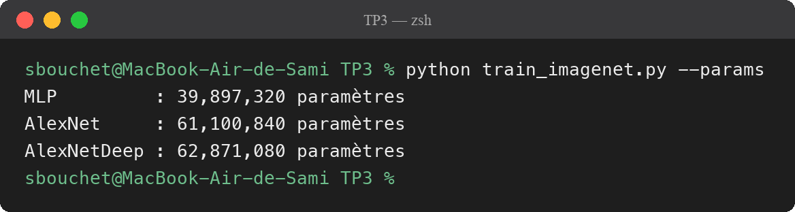
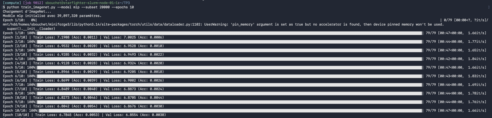
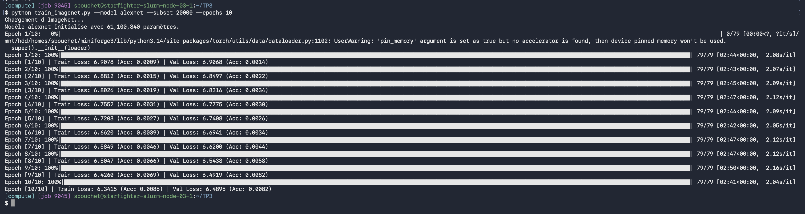
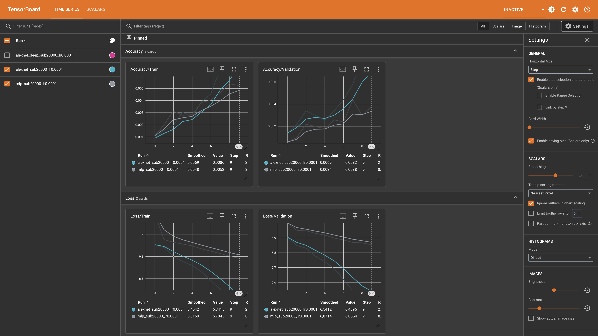
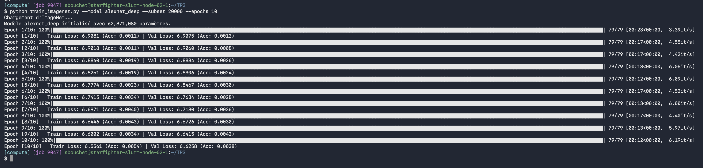
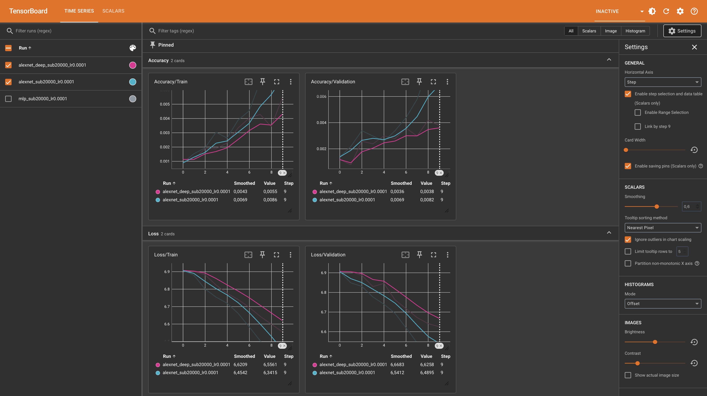
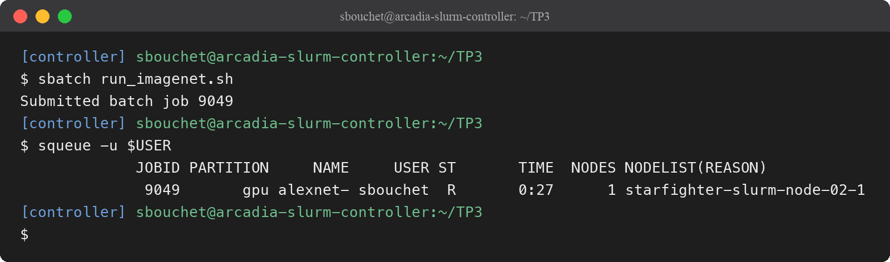
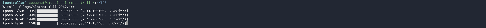
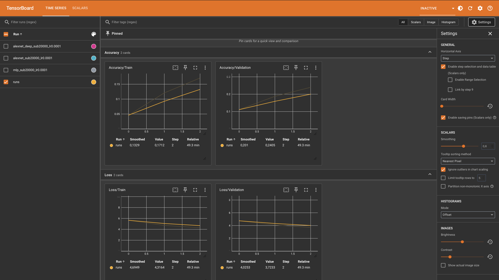

# TP3 — Réseaux convolutifs (CSC 8607 – Introduction au deep learning)

---

## Exercice 1 — Préparation d'ImageNet et augmentation de données

### Si on oublie `transforms.Normalize`

Sans normalisation, les pixels restent entre 0 et 1, donc toutes les entrées sont positives et pas centrées. Du coup, les gradients des poids d'un même neurone ont tous le même signe et les poids bougent tous dans le même sens, ce qui fait zigzaguer la descente de gradient. L'entraînement est plus lent et moins stable, et il faut un learning rate plus petit.

Les statistiques doivent être calculées seulement sur le train pour éviter une fuite d'information : sinon, on utilise des infos de la validation avant de l'évaluer, et elle n'est plus indépendante.

### Transformations différentes entre train et validation

Sur le train, `RandomResizedCrop` et `RandomHorizontalFlip` donnent une version différente de chaque image à chaque époque. Ça fait plus de diversité et ça limite le sur-apprentissage.

Sur la validation, on veut un résultat déterministe pour pouvoir comparer les époques et les modèles. On fait donc juste `Resize` + `CenterCrop` pour avoir la bonne taille, sans hasard.

### Exemple où le flip horizontal serait néfaste

Des panneaux « tourner à gauche » et « tourner à droite » : si on retourne l'image, un panneau gauche devient un panneau droite mais garde l'étiquette « gauche ». Même chose pour des lettres comme b et d.

---

## Exercice 2 — MLP vs AlexNet

### Nombre de paramètres du MLP

- Linear1 : 154 587 × 256 + 256 = 39 574 528
- Linear2 : 256 × 256 + 256 = 65 792
- Linear3 : 256 × 1000 + 1000 = 257 000

**Total avec biais : 39 897 320. Sans biais : 39 895 808.**

C'est la première couche qui concentre plus de 99 % des paramètres (≈ 99,2 %), car chaque pixel est relié à chaque neurone.

### Défaut structurel du MLP

Avec le `flatten`, on perd la structure spatiale de l'image : le MLP ne sait pas quels pixels sont voisins. Il n'est pas non plus invariant par translation : un même objet décalé de quelques pixels utilise des poids complètement différents.

### Tableau AlexNet

| Couche | Taille entrée | Hyperparamètres | Taille sortie | # Paramètres | Mémoire sortie (KB) |
|--------|---------------|-----------------|---------------|-------------:|--------------------:|
| Conv1 + ReLU | 3, 227×227 | 64, K=11, S=4, P=2 | 64, 56×56 | 23 296 | 784 |
| MaxPool1 | 64, 56×56 | K=3, S=2, P=0 | 64, 27×27 | 0 | 182,25 |
| Conv2 + ReLU | 64, 27×27 | 192, K=5, S=1, P=2 | 192, 27×27 | 307 392 | 546,75 |
| MaxPool2 | 192, 27×27 | K=3, S=2, P=0 | 192, 13×13 | 0 | 126,75 |
| Conv3 + ReLU | 192, 13×13 | 384, K=3, S=1, P=1 | 384, 13×13 | 663 936 | 253,5 |
| Conv4 + ReLU | 384, 13×13 | 256, K=3, S=1, P=1 | 256, 13×13 | 884 992 | 169 |
| Conv5 + ReLU | 256, 13×13 | 256, K=3, S=1, P=1 | 256, 13×13 | 590 080 | 169 |
| MaxPool3 | 256, 13×13 | K=3, S=2, P=0 | 256, 6×6 | 0 | 36 |
| Flatten + Dropout | 256, 6×6 | p = 0,5 | 9216 | 0 | 36 |
| Linear1 + ReLU + Dropout | 9216 | 4096 (p = 0,5) | 4096 | 37 752 832 | 16 |
| Linear2 + ReLU | 4096 | 4096 | 4096 | 16 781 312 | 16 |
| Linear3 | 4096 | 1000 | 1000 | 4 097 000 | 3,91 |
| **Total** | | | | **61 100 840** | **≈ 2339** |

Formules utilisées : sortie = ⌊(H + 2P − K)/S⌋ + 1, paramètres d'une conv = C_out × (C_in × K × K + 1), mémoire = nb de valeurs × 4 / 1024.

### Paramètres et mémoire des activations

- Les **paramètres** sont surtout dans les couches **linéaires** (≈ 96 %, dont 37,7 M pour Linear1 seule).
- La **mémoire des activations** est surtout dans les **premières convolutions** (Conv1, MaxPool1 et Conv2 font ≈ 65 % des 2339 KB), car les cartes de caractéristiques y sont encore grandes.

### Comparaison avec le MLP

Le MLP produit seulement 256 + 256 + 1000 valeurs, soit environ 6 KB d'activations (≈ 610 KB si on compte l'image aplatie), contre ≈ 2340 KB pour AlexNet.

Dans le MLP, la première couche a énormément de poids mais elle réduit tout de suite l'image à 256 valeurs. Dans AlexNet, les convolutions partagent leurs poids : un filtre a peu de paramètres, mais il est appliqué à chaque position et produit une grande carte de sortie. Donc le MLP a beaucoup de poids et peu d'activations, et AlexNet a peu de poids dans ses convolutions mais beaucoup d'activations.

### Vérification avec `count_parameters`

On retrouve bien les valeurs calculées à la main.

---

## Exercice 3 — Entraînement, Early Stopping et comparaison

Entraînements sur 10 époques avec `subset_size=20000` :

### `model.eval()` et `model.train()`

`model.train()` active le Dropout, qui éteint au hasard 50 % des neurones à chaque passage. `model.eval()` le désactive, et tout le réseau est utilisé.

Si on oubliait `model.eval()`, le Dropout resterait actif pendant l'évaluation. Les prédictions seraient aléatoires et moins bonnes, donc l'accuracy de validation serait sous-estimée, et ça fausserait aussi l'early stopping.

### Valeurs à l'initialisation

Au hasard, l'accuracy vaut 1/1000 = **0,1 %** et la loss vaut ln(1000) ≈ **6,91**.

C'est cohérent avec mes résultats : à la 1ère époque, AlexNet a une loss de 6,91 et une accuracy de 0,1 %. Le MLP démarre un peu plus haut (7,19), mais il revient vers 6,95 dès l'époque 2.

### Comparaison MLP vs AlexNet

| Époque 10 | Train Loss | Train Acc | Val Loss | Val Acc |
|-----------|-----------:|----------:|---------:|--------:|
| MLP | 6,78 | 0,53 % | 6,86 | 0,38 % |
| AlexNet | 6,34 | 0,86 % | 6,49 | 0,82 % |

**AlexNet apprend le mieux** : sa loss baisse plus vite et son accuracy de validation est deux fois plus élevée. Les convolutions exploitent la structure de l'image.

C'est le **MLP qui sur-apprend le plus vite** : son accuracy de train continue de monter alors que celle de validation stagne. Il a 40 M de paramètres pour seulement 20 images par classe, pas de Dropout, et pas de structure spatiale, donc il apprend les pixels par cœur. Sur 10 époques, ça reste quand même léger pour les deux.

### Impact de la profondeur

Le réseau plus profond met plus de temps à démarrer : sa loss reste bloquée vers 6,91 pendant 2 époques, puis il reste en retard. À l'époque 10, il est à 6,56 en train et 0,38 % en validation, contre 6,34 et 0,82 % pour AlexNet.

C'est du **sous-apprentissage** : c'est la loss de **train** qui reste haute, alors que le modèle a plus de paramètres. Il n'arrive pas à apprendre.

Ça s'explique par le **vanishing gradient** : pendant la backpropagation, le gradient est un produit des dérivées de chaque couche. Avec plus de couches, et sans BatchNorm ni connexions résiduelles, ce produit devient très petit, donc les premières couches n'apprennent presque pas au début.

---

## Exercice 4 — Entraînement long via sbatch

J'ai dû ajouter `--account=csc_8607` et `--qos=normal` dans `run_imagenet.sh`, sinon le cluster refusait le job.

### Profilage

- Une époque prend environ **23 min 30 s** d'entraînement, plus environ 1 min de validation, soit **≈ 24 min**.
- Pour 100 époques : 100 × 24 min ≈ **40 heures**.

### Analyse de l'entraînement

| Époque | Train Loss | Train Acc | Val Loss | Val Acc |
|-------:|-----------:|----------:|---------:|--------:|
| 1 | 5,68 | 4,6 % | 4,76 | 11,2 % |
| 2 | 4,74 | 12,1 % | 4,09 | 18,9 % |
| 3 | 4,32 | 17,1 % | 3,72 | 24,1 % |

Sur le subset, la loss de validation finissait au-dessus de celle de train (+0,15 à l'époque 10). Ici, elle est en dessous (−0,59 à l'époque 3), donc il n'y a pas de sur-apprentissage.

C'est parce qu'il y a 1,28 million d'images (≈ 1280 par classe) au lieu de 20 000. Avec la data augmentation, le modèle ne voit jamais deux fois exactement la même image, donc il ne peut pas apprendre par cœur.

### Pourquoi Val Loss < Train Loss ?

1. Le **Dropout** est actif pendant le train mais pas pendant la validation : en validation, on utilise le réseau complet, qui prédit mieux.
2. La **data augmentation** n'est appliquée qu'au train : `RandomResizedCrop` peut couper une grosse partie de l'objet, alors qu'en validation l'image est juste centrée. Les images de train sont donc plus difficiles.
