# TP4 — Réseaux récurrents et génération de séquences (CSC 8607 – Introduction au deep learning)

---

## Exercice 1 — Exploration et prétraitement des partitions ABC

### Étape 1 : Chargement et découverte du jeu de données

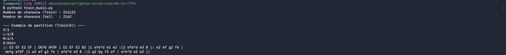

**1.** Il y a 214 122 partitions dans `train.json` et 2 162 dans `validation.json`.

**2.** Les métadonnées d'en-tête vont permettre de changer le ton et le rythme de la partition. Dans la première partition on a :

- `X:1` : le numéro de la partition
- `L:1/8` : la durée par défaut d'une note (une croche)
- `M:4/4` : la mesure, donc le rythme
- `K:Emin` : la tonalité (mi mineur)

Sans ces infos, le lecteur ne saurait pas comment jouer les notes.

### Étape 2 : Construction du vocabulaire et padding

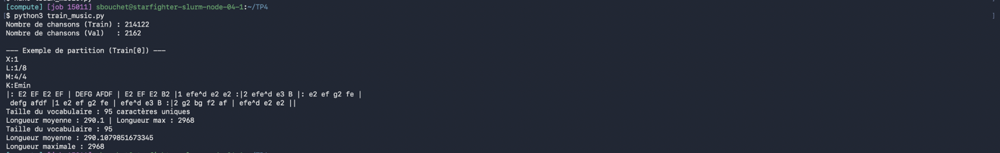

**1.** Le vocabulaire contient 95 caractères uniques. La longueur moyenne des partitions est de 290,1 caractères et la longueur maximale est de 2968 caractères.

**2.** On utilise `sorted()` pour garder toujours le même ordre des caractères et donc les mêmes indices. Un `set` n'a pas d'ordre fixe en Python, donc sans `sorted()` les indices pourraient changer entre deux exécutions, et le modèle sauvegardé la veille risquerait de générer une musique incorrecte car les caractères ne correspondraient plus aux mêmes indices.

**3.** On choisit `SEQ_LENGTH = 500` pour éviter de traiter des séquences trop longues. Si on utilisait `max_len` (2968, environ 6 fois plus), cela augmenterait beaucoup le temps de calcul et la mémoire GPU utilisée. Le modèle apprendrait aussi sur beaucoup d'espaces inutiles (padding), vu que la moyenne est de 290 caractères, ce qui pourrait nuire à son apprentissage.

---

## Exercice 2 — Dataset PyTorch auto-régressif et modélisation

### Étape 1 : Création du `MusicDataset`

Les tenseurs `x` et `y` ont les dimensions (128, 499) :

- 128 : nombre de séquences dans un batch.
- 499 : nombre de caractères par séquence (500 − 1).

On utilise `torch.long` car les caractères sont représentés par des indices entiers, nécessaires pour la couche d'embedding du modèle (et pour la loss). `torch.float32` est utilisé pour les nombres décimaux, pas pour ces indices.

### Étape 2 : Architecture récurrente (RNN vs LSTM)

#### Question 1 — Calcul des paramètres

Avec `vocab_size = 95`, `embedding_dim = 256` et `hidden_size = 512` :

Pour le RNN :

- Embedding : 95 × 256 = 24 320
- RNN : (512 × 256) + (512 × 512) + (2 × 512) = 394 240
- Linear : (512 × 95) + 95 = 48 735

**Total RNN : 467 295 paramètres.**

Pour le LSTM :

- Embedding : 24 320
- LSTM : 4 × 394 240 = 1 576 960
- Linear : 48 735

**Total LSTM : 1 650 015 paramètres.**

Vérification avec `count_parameters` :


On retrouve bien les valeurs calculées à la main.

Le bloc LSTM possède 4 fois plus de paramètres que le bloc RNN car il utilise 4 portes/calculs internes (entrée, oubli, sortie et candidat mémoire), chacun ayant ses propres poids et deux vecteurs de biais.

#### Question 2 — Pourquoi utiliser `nn.Embedding` ?

`nn.Embedding` permet de représenter chaque caractère par un vecteur de valeurs apprises indépendamment.

Contrairement à une couche linéaire appliquée à un simple indice, elle n'impose pas de relation numérique artificielle entre les caractères (par exemple le caractère 40 n'est pas « deux fois » le caractère 20) et permet au modèle d'apprendre de meilleures représentations.

#### Question 3 — Différence entre `hidden_state` du RNN et du LSTM

- RNN : retourne un seul état caché `h_n`, qui contient les informations mémorisées.
- LSTM : retourne deux états `(h_n, c_n)` :
  - `h_n` : état caché, utilisé pour produire les sorties.
  - `c_n` : état de cellule, qui conserve les informations sur le long terme.

Le LSTM gère donc mieux les dépendances longues grâce à sa mémoire supplémentaire.

---

## Exercice 3 — Entraînement, dynamique des gradients et comparaison RNN vs LSTM

### Question 1 — Manipulation des tenseurs

On utilise `reshape()` pour transformer les tenseurs au format attendu par `CrossEntropyLoss`, qui veut des logits en 2D et des cibles en 1D.

- `logits.reshape(-1, vocab_size)` donne une dimension de (63872, 95).
- `y.reshape(-1)` donne une dimension de (63872).

La valeur 63872 = 128 × 499 représente le nombre total de caractères à prédire dans un batch complet.

### Question 2 — Ordre des opérations

On applique `clip_grad_norm_` après `loss.backward()` car les gradients doivent d'abord être calculés.

On l'applique avant `optimizer.step()` pour limiter les gradients trop grands avant la mise à jour des poids, afin de stabiliser l'entraînement. Si on le faisait après, les poids seraient déjà mis à jour et ça ne servirait à rien.

### Question 3 — Analyse expérimentale RNN vs LSTM

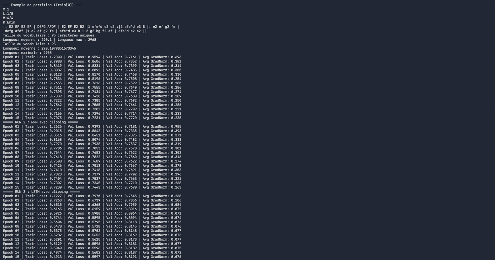

Courbes TensorBoard (gris : RNN sans clipping, bleu : RNN avec clipping, rose : LSTM) :

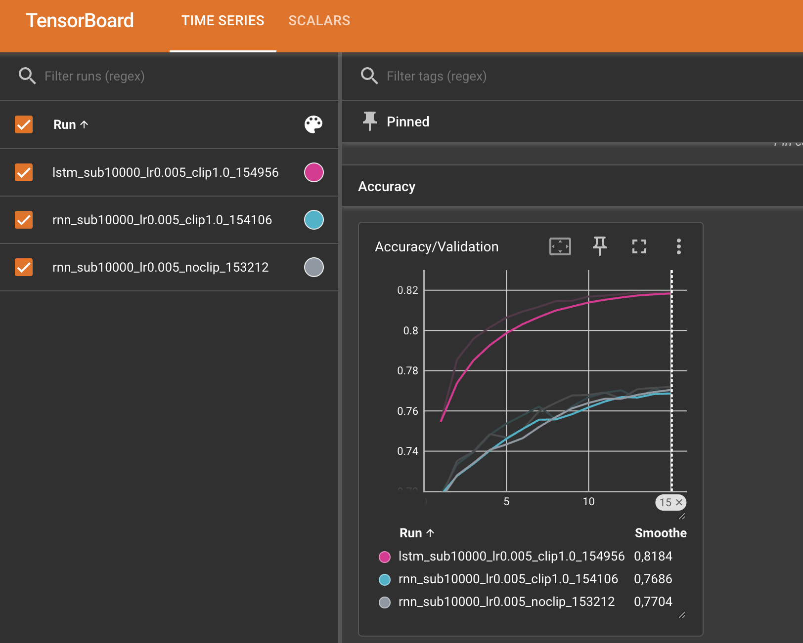

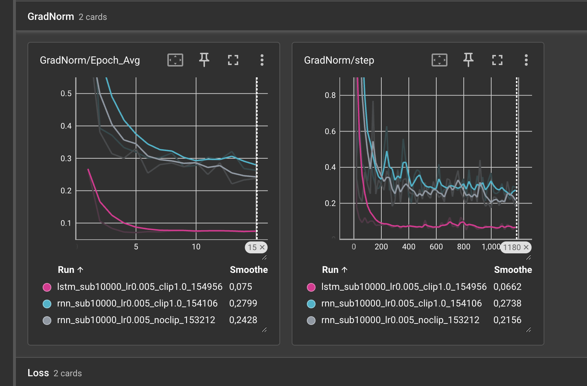

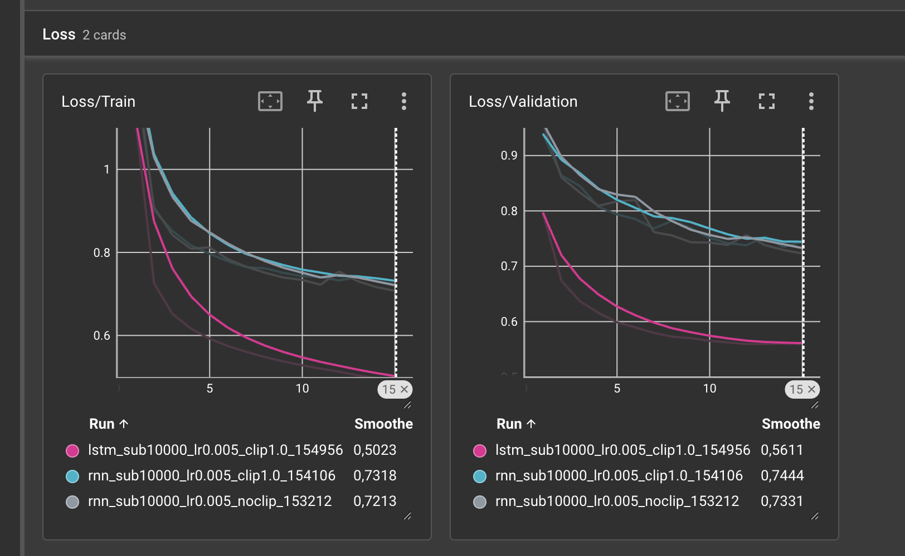

#### a) Comparaison Run 1 et Run 2 : RNN sans et avec clipping

Les deux modèles obtiennent des performances proches (époque 15) :

- Sans clipping : Loss = 0,7231 et Accuracy = 77,20 %.
- Avec clipping : Loss = 0,7443 et Accuracy = 76,90 %.

Les courbes montrent une diminution progressive de la perte dans les deux cas, sans instabilité majeure. La norme des gradients est plus grande au début puis elle descend autour de 0,2-0,3 pour les deux.

Le gradient clipping permet de limiter les gradients trop élevés et d'éviter le problème des exploding gradients : dans un RNN, le gradient est multiplié par la même matrice de poids à chaque pas de temps, donc il peut exploser sur des longues séquences. Ici la norme reste presque toujours en dessous de 1, donc le clipping ne s'active quasiment pas, c'est pour ça qu'il n'apporte pas d'amélioration notable.

#### b) Comparaison Run 2 et Run 3 : RNN vs LSTM

Le LSTM obtient de meilleurs résultats :

- RNN : Loss = 0,7443 et Accuracy = 76,90 %.
- LSTM : Loss = 0,5597 et Accuracy = 81,91 %.

Le LSTM converge plus rapidement : dès l'époque 2 il est déjà meilleur que le RNN à la fin. La norme moyenne des gradients est également plus faible pour le LSTM (environ 0,075 contre 0,28 pour le RNN avec clipping).

Le LSTM utilise des portes pour contrôler les informations conservées en mémoire. Son état mémoire est calculé par :

$$c_t = f_t \odot c_{t-1} + i_t \odot \tilde{c}_t$$

La porte d'oubli $f_t$ permet de conserver les informations précédentes lorsqu'elle est proche de 1. Comme la mise à jour est une addition et pas une multiplication par une matrice comme dans le RNN, le gradient passe mieux d'un pas à l'autre. Cela facilite l'apprentissage des dépendances longues dans les partitions musicales.

#### Conclusion

Le LSTM est le modèle le plus performant dans notre expérience. Il obtient la meilleure accuracy (81,91 %) et la plus faible perte de validation (0,5597). Le gradient clipping permet de prévenir les explosions de gradients, mais son effet sur les performances des RNN n'est pas significatif dans nos résultats.

### Question 4 — Problème du padding

L'accuracy est artificiellement élevée, car le modèle prédit beaucoup d'espaces ajoutés par le padding, et pas uniquement des notes de musique. Après un espace de padding, il suffit de prédire encore un espace, c'est facile.

Pour ignorer ces espaces dans la perte, on peut utiliser :

```python
loss_fn = nn.CrossEntropyLoss(ignore_index=char_to_index[" "])
```

Cela empêche les espaces de contribuer au calcul de la perte. Par contre ça ignore aussi les vrais espaces de la partition, donc l'idéal serait d'utiliser un caractère spécial juste pour le padding.

---

## Exercice 4 — Génération musicale, température et job Slurm

### Étape 1 : Génération avec propagation de l'état caché

#### Question 1 — Efficacité algorithmique

Si on repasse toute la séquence au modèle à chaque étape, la complexité totale est O(N²) pour générer N caractères, en supposant une amorce de longueur fixe.

En conservant `hidden_state` et en traitant un seul caractère à chaque étape, la complexité devient O(N). Cette méthode est donc beaucoup plus rapide.

#### Question 2 — Rôle de la température

- T → 0 : le modèle choisit presque toujours le caractère le plus probable. Cela correspond au greedy decoding.
- T → +∞ : les probabilités deviennent presque uniformes. Tous les caractères ont quasiment la même chance d'être choisis.

Une température basse rend la génération plus prévisible, tandis qu'une température élevée augmente la diversité, mais aussi le risque d'erreurs.

#### Question 3 — Analyse des musiques générées

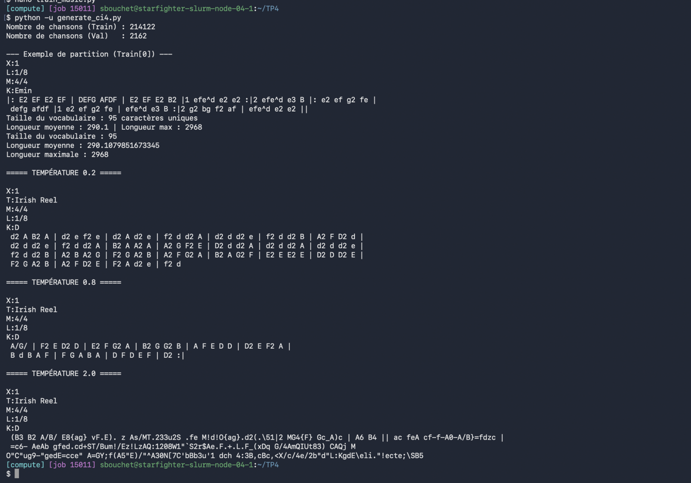

**T = 0.2**

```
X:1
T:Irish Reel
M:4/4
L:1/8
K:D
 d2 A B2 A | d2 e f2 e | d2 A d2 e | f2 d d2 A | d2 d d2 e | f2 d d2 B | A2 F D2 d |
 d2 d d2 e | f2 d d2 A | B2 A A2 A | A2 G F2 E | D2 d d2 A | d2 d d2 A | d2 d d2 e |
 f2 d d2 B | A2 B A2 G | F2 G A2 B | A2 F G2 A | B2 A G2 F | E2 E E2 E | D2 D D2 E |
 F2 G A2 B | A2 F D2 E | F2 A d2 e | f2 d
```

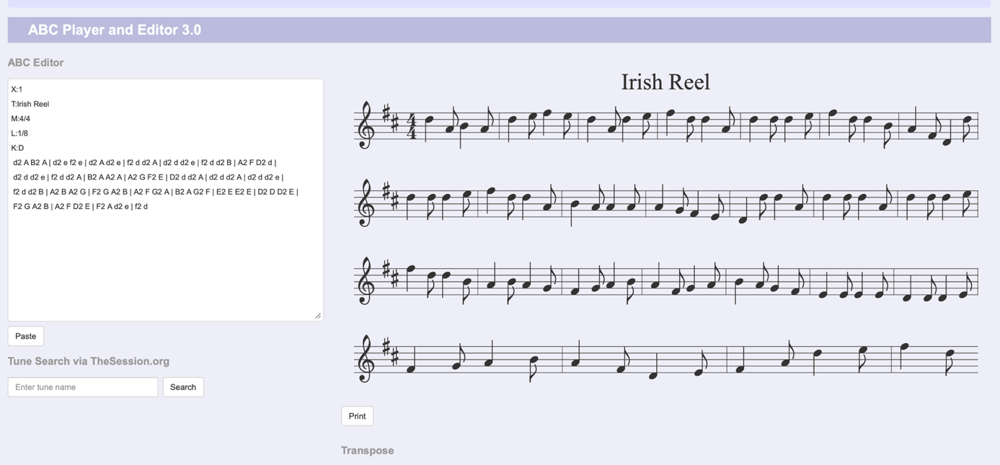

La partition est assez cohérente, mais très répétitive. Le modèle utilise souvent les mêmes notes et motifs musicaux. Les barres de mesure sont présentes, mais la structure rythmique n'est pas correcte : les mesures font 6 croches au lieu de 8 pour du 4/4.

**T = 0.8**

```
X:1
T:Irish Reel
M:4/4
L:1/8
K:D
 A/G/ | F2 E D2 D | E2 F G2 A | B2 G G2 B | A F E D D | D2 E F2 A |
 B d B A F | F G A B A | D F D E F | D2 :|
```

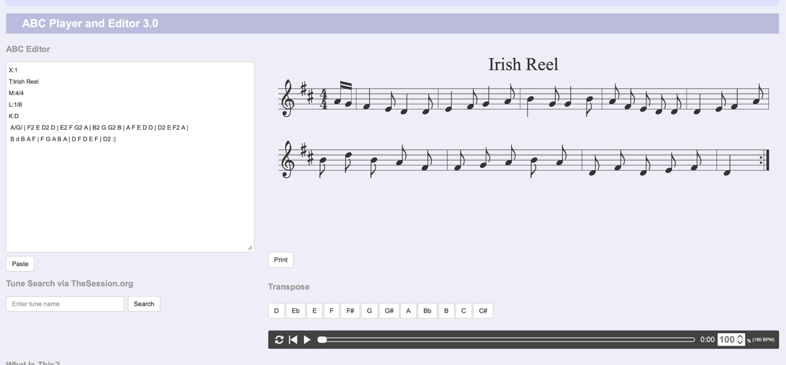

La musique est plus variée et reste globalement cohérente. Les notes et les barres de mesure respectent davantage la syntaxe ABC, il y a même une reprise `:|` à la fin. Cette température semble offrir le meilleur équilibre entre diversité et cohérence.

**T = 2.0**

```
X:1
T:Irish Reel
M:4/4
L:1/8
K:D
 (B3 B2 A/B/ E8{ag} vF.E). z As/MT.233u2S .fe M!d!O{ag}.d2(.\51|2 MG4{F} Gc_A)c | A6 B4 || ac feA cf-f-A0-A/B}=fdzc |
 =c6- AeAb gfed.cd+ST/Bum!/Ez!LzAQ:1208W1"`S2r$Ae.F.+.L.F_(xDq G/4AmQIUt83) CAQj M
O"C"ug9-"gedE=cce" A=GY;f(A5"E)/"^A30N[7C'bBb3u'1 dch 4:3B,cBc,<X/c/4e/2b"d"L:KgdE\eli."!ecte;\SB5
```

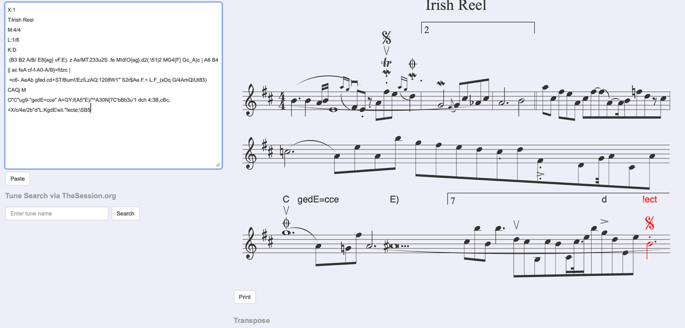

La génération devient très aléatoire. On observe beaucoup de caractères incohérents et d'erreurs de syntaxe ABC. La partition n'est pas correctement interprétée par le lecteur musical (il y a des erreurs en rouge).

**Conclusion :** une température trop basse produit des répétitions, tandis qu'une température trop élevée génère du chaos. Dans nos résultats, T = 0.8 semble être le meilleur compromis pour générer des partitions variées et cohérentes.

### Étape 2 : Entraînement à plus grande échelle via sbatch

On lance le job avec `sbatch run_music.sh` (LSTM, `hidden_size=1024`, `subset_size=50000`, clipping à 1.0, 30 époques) et on suit l'entraînement avec `tail -f` sur le fichier de log.

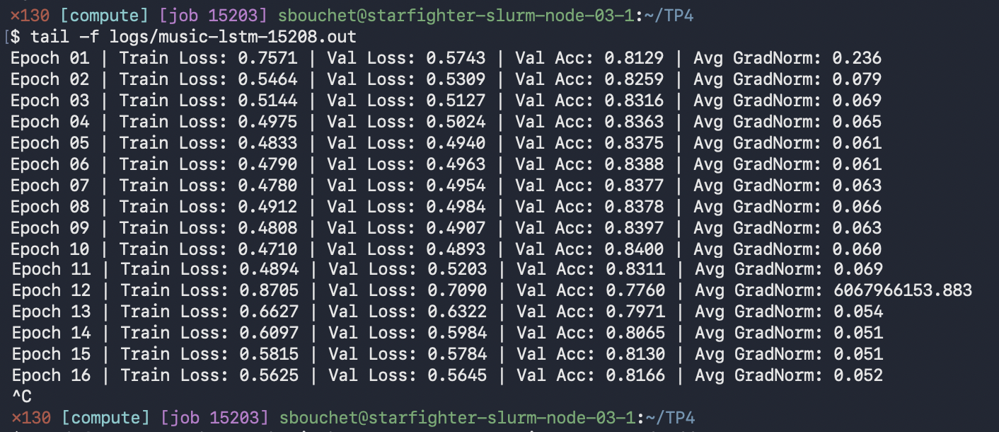

Le modèle est bien meilleur que celui de la séance : dès l'époque 1 il est presque au niveau du Run 3, et le meilleur résultat est à l'époque 10 avec une Val Loss de 0,4893 et une accuracy de 84,00 %. Après l'époque 5 la loss ne baisse presque plus, le modèle arrive à un plateau.

À l'époque 12 on voit une explosion des gradients (norme moyenne d'environ 6 × 10⁹) et la loss remonte (0,7090 en validation). Le clipping a quand même limité les dégâts : la valeur affichée est la norme avant le clipping, donc les poids n'ont pas été mis à jour avec un gradient aussi grand, sinon le modèle aurait divergé. Il redescend ensuite à 0,5645 à l'époque 16. Comme on sauvegarde seulement le meilleur modèle, c'est celui de l'époque 10 qui est gardé.

#### Génération avec le modèle Slurm

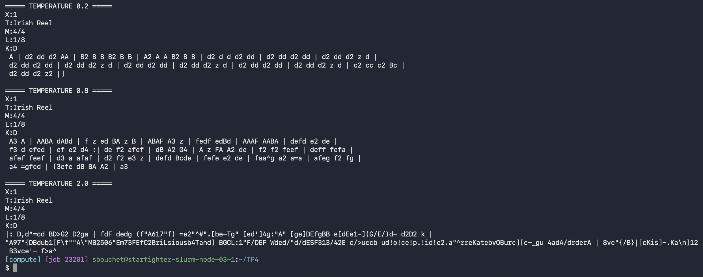

**T = 0.2**

```
X:1
T:Irish Reel
M:4/4
L:1/8
K:D
 A | d2 dd d2 AA | B2 B B B2 B B | A2 A A B2 B B | d2 d d d2 dd | d2 dd d2 dd | d2 dd d2 z d |
 d2 dd d2 dd | d2 dd d2 z d | d2 dd d2 dd | d2 dd d2 z d | d2 dd d2 dd | d2 dd d2 z d | c2 cc c2 Bc |
 d2 dd d2 z2 |]
```

**T = 0.8**

```
X:1
T:Irish Reel
M:4/4
L:1/8
K:D
 A3 A | AABA dABd | f z ed BA z B | ABAF A3 z | fedf edBd | AAAF AABA | defd e2 de |
 f3 d efed | ef e2 d4 :| de f2 afef | dB A2 G4 | A z FA A2 de | f2 f2 feef | deff fefa |
 afef feef | d3 a afaf | d2 f2 e3 z | defd Bcde | fefe e2 de | faa^g a2 a=a | afeg f2 fg |
 a4 =gfed | (3efe dB BA A2 | a3
```

**T = 2.0**

```
X:1
T:Irish Reel
M:4/4
L:1/8
K:D
|: D,d^=cd BD>G2 D2ga | fdF dedg (f"A617"f) =e2"^#".[be-Tg" [ed']4g:"A" [ge]DEfgBB e[dEe1-](G/E/)d- d2D2 k |
"A97"{DBdub1[F\f""A\"MB2506"Em73FEfC2BriLsiousb4Tand] BGCL:1"F/DEF Wded/"d/dESF313/42E c/>uccb ud!o!ce!p.!id!e2.a"^rreKatebvOBurc][c-_gu 4adA/drderA | 8ve"{/B}|[cKis]-.Ka\n]12
 B3vce'- f>a^
```

Par rapport au modèle de la séance :

- T = 0.2 : toujours très répétitif, mais cette fois les mesures font bien 8 croches, donc le 4/4 est respecté.
- T = 0.8 : c'est le meilleur résultat. Les mesures sont correctes, il y a une reprise `:|` après 8 mesures puis une deuxième partie, comme dans un vrai reel.
- T = 2.0 : toujours le chaos, la température est trop haute peu importe le modèle.

Le modèle plus gros a donc mieux appris la structure des partitions, ce qui colle avec sa val loss plus basse.
